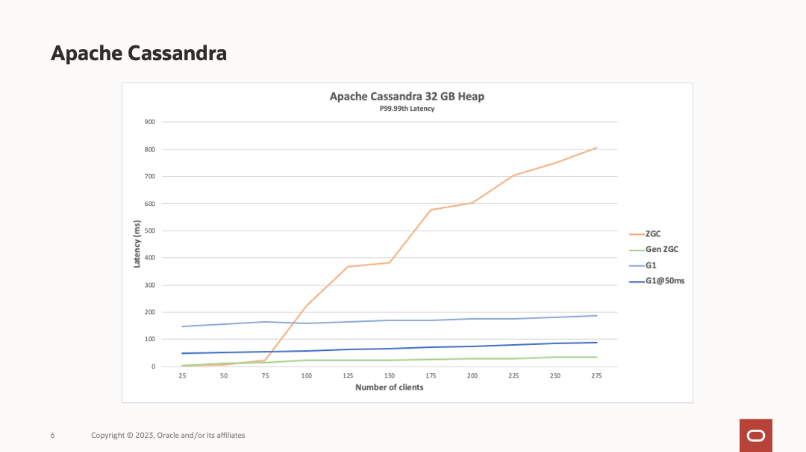
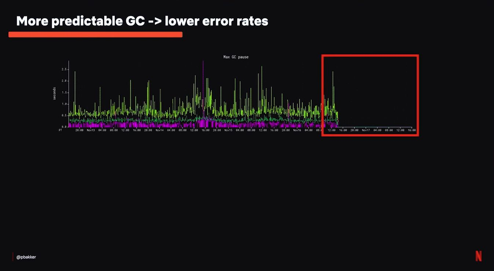
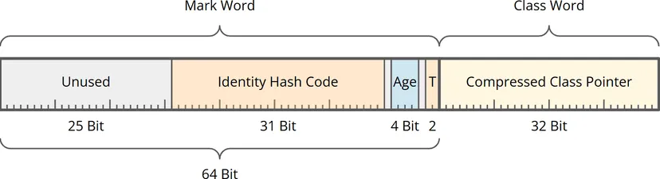
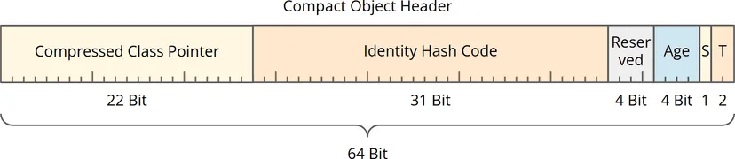
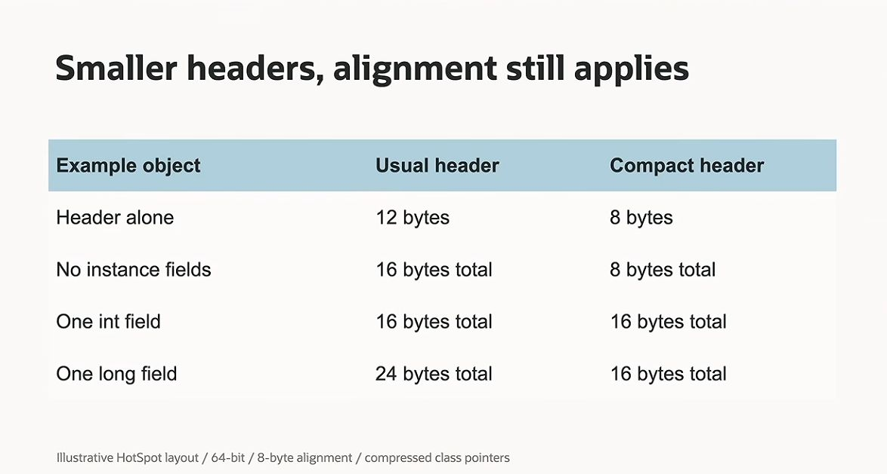
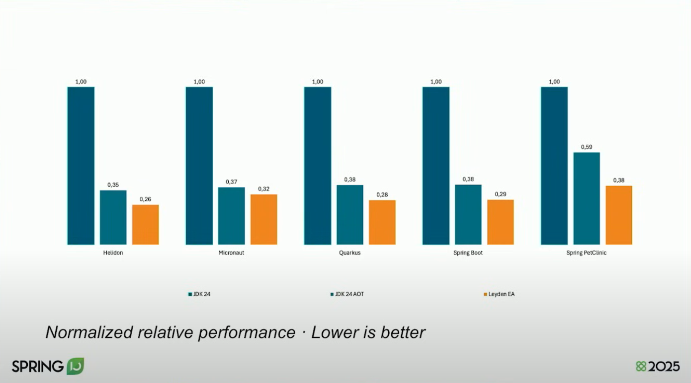
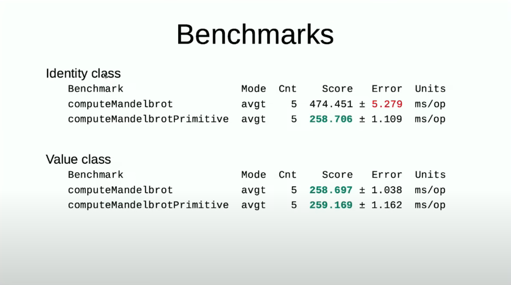

# Bevezetés

## Performancia a cloud és AI világában

## Figyelembe vett Java verziók

- Java SE 21 LTS 2023. szeptember
- Java SE 25 LTS 2025. szeptember
- Java SE 27 2026. szeptember
- Java SE 28 Early-Access

Üzleti alkalmazásokra koncentrálva, kihagyva a natív kód futtatási lehetőségét (Foreign Function & Memory API)

## Fejlesztések



## Egyéb fejlesztések

Csak a JEP-re koncentrálva, de vannak issue-k is

Amikre nincs JEP, OpenJDK issue: interpreter, JIT

- [Performance Improvements in JDK 24](https://inside.java/2025/03/19/performance-improvements-in-jdk24/)
- [Performance Improvements in JDK 25](https://inside.java/2025/10/20/jdk-25-performance-improvements/)
- [Performance Improvements in JDK 26](https://inside.java/2026/06/09/jdk-26-performance-improvements/)
- [Performance Improvements in JDK 27](https://inside.java/2026/09/28/performance-update-jdk27/)

Források:

- [From JDK 21 to JDK 25 - Java Performance Update 2025](https://www.youtube.com/watch?v=223_7r0H6OE)
- [Java Performance Update - 2026](https://www.youtube.com/watch?v=1d9t8R20V10)

# GC

## GC alapfogalmak

* Generational, weak-generational hypothesis
* Young generation és old generation
* Az objektumok a young generationön születnek
* GC után a megmaradtak átkerülnek az old generationbe
* Minor GC, Full GC
* Stop the world
* Parallel: több szálon fut a szemétgyűjtő algoritmus
* Concurrent: az alkalmazás futásával párhuzamosan

## G1

* Garbage-First
* Java SE 7-ben jelent meg
* Stop-the-world fázisban sok minden történik
* A memóriát régiókra osztja
* Bizonyos régiókat az eden, survivor vagy az old területhez rendeli
* A legtöbb szemetet tartalmazó régiókat üríti, innen ered a neve is
* Még élő objektumokat más régiókba másolja

## ZGC

* Z Garbage Collector
* 11-ben még csak kísérleti, 15-ben lesz production ready
* Szintén régiós
* Terabyte nagyságú heap-ek kezelésére
* Erősen concurrent, nagyobb CPU és memória, rövid stop-the-world
* Nem írja át azonnal a referenciákat, hanem forwarding table vezet át a régi címről az új címre
* Színes pointerek, a referencia állapota
* Load barrier
    - JVM által beillesztett kódrészletek, melyek az objektum referencia alapján történő betöltésekor futnak le
    - Követik az átvezetést, és írják vissza az új címet, időben eltolva

## Shenandoah

* Java 12-ben experimental, 15-ben végleges
* Szintén régiós
* Szintén erősen concurrent, nagyobb CPU és memória, rövid stop-the-world
* Indirection (brooks) pointer: objektum headerben lévő plusz adat, mely az átmozgatott
  objektumra mutat
* Az eredeti objektumot nem törli, hanem beállítja a pointert, így az alkalmazással
    párhuzamosan képes futni
* Szintén load barrier kezeli a pointereket

## GC fejlesztések

- Java 23 - JEP 474: ZGC: Generational Mode by Default
- Java 24 - JEP 475: Late Barrier Expansion for G1
- Java 24 - JEP 490: ZGC: Remove the Non-Generational Mode
- Java 25 - JEP 521: Generational Shenandoah
- Java 26 - JEP 522: G1 GC: Improve Throughput by Reducing Synchronization
- Java 27 - JEP 523: Make G1 the Default Garbage Collector in All Environments
- Java 28 - JEP 535: Shenandoah GC: Generational Mode by Default
- Java 28 - JEP 545: Faster Startup and Warmup with ZGC
- Java 28 - JEP 546: Adaptive Heap Sizing for ZGC

## Esettanulmány



## Esettanulmány

Netflix

- sok memória, 1,5 sec -> timeoutok




[Paul Bakker: How Netflix Uses Java - 2026 Edition at JavaOne 2026](https://www.youtube.com/watch?v=ucJTPda_zx0&t=7s)

## JEP 545: Faster Startup and Warmup with ZGC

- Szorosan együtt a JEP 546: Adaptive Heap Sizing for ZGC fejlesztéssel
    - Dinamikusan igazítsa a heap méretét a rendelkezésre álló memóriához és az alkalmazás igényeihez
- A ZGC-nek ne kelljen választania a gyors indulás és a gyors bemelegedés között
- A JVM már induláskor használhat egy nagyon kis heapet, miközben a ZGC a háttérben, párhuzamosan előkészíti és bővíti a memóriát
- Így az alkalmazás gyorsabban elindulhat, miközben a heap fokozatos növelése sem jár akkora teljesítményveszteséggel

A [JEP 454](https://openjdk.org/jeps/545) bemutat egy Spring PetClinic-alapú tesztet

| Eset | Startup | Warmup |
|--|--|--|
Kis kezdeti heap | 5,86 s | 80 s
Nagy kezdeti heap | 9,45 s | 10 s
Új ZGC | 5,84 s | 10 s

Nem kell kompromisszum a gyors startup és gyors warmup között

# Project Lilliput, Compact Object Headers

## Compact Object Headers

- Java 25 - JEP 519: Compact Object Headers
- Java 27 - JEP 534: Compact Object Headers by Default

- Sok alkalmazás alapvetően sok kis objektumokkal dolgozik



- A header kis objektumok esetén jelentős overhead



- Identity Hash Code: `System.identityHashCode(Object)`
- T: lock információk
- S: self forwarded: GC már feldolgozta, de nem tudta elmozgatni
- 22 bit compressed: 4 GB-os terület, de nem akarunk minden bájtot címezni, 1024 byte-os blokkokra van osztva, és elég a blokk elejére hivatkozni



Alignmentet is figyelembe kell venni

- Kevesebb memóriafoglalás (10 - 20% heap megtakarítás)
- Gyorsabb GC futás

# Project Loom, Threads

## Fejlesztések

- Java 21 Virtual threads
- Java 24 - JEP 491: Synchronize Virtual Threads without Pinning
- Java 25 - JEP 506: Scoped Values
    - Related: Structured concurrency

## Virtual threads

* Virtual threads
  * JVM által (és nem az OS által) vezérelt szálak
  * Nem költséges, akár több millió is létrehozható, nem kell poolozni
  * Leképezhető platform szálra, carrier threads
  * IO-ra várás (fájl, hálózat) az OS szálakkal ellentétben nem erőforrásigényes
  * Performancia szempontjából kiválthatják a reaktív programozást
* Pinning: virtuális szál nem tud leválni a platform szálról, így az adott platform szál nem tud váltogatni más virtuális szálak között

## JEP 491: Synchronize Virtual Threads without Pinning

- Pinning: virtuális szál nem tud leválni a platform szálról, így az adott platform szál nem tud váltogatni más virtuális szálak között
- Java 24-től a monitor (synchronized) tulajdonosa mostantól a virtuális szál, nem a carrier szál. Ezért a virtuális szál blokkolás közben leválhat (unmount) a carrierről akkor is, ha monitort tart.

## JEP 506: Scoped Values

- Paraméterek átadására metódusok között úgy, hogy nem visszük tovább metódus paraméterként
- Szálanként más értéket vehet fel
- Immutable
- `ThreadLocal` kiváltására
    - Pool használata esetén érték benne maradhat
    - Mutable
    - Nem, tudni, hol írják
    - Nincs életciklusa
    - Nem lehet megkülönböztetni, hogy nincs feltöltve vagy null
    - `InheritableThreadLocal` esetén a gyerek szálakba lemásolásra kerül, sok helyet foglal
    - Virtual thread: sok van belőle, sok lesz a ThreadLocal is

## Példa

`ScopedValueApplication`

## Structured Concurrency - forráskód

```java
try (var scope = StructuredTaskScope.open()) {
    var employeeTask = scope.fork(() -> {
        log.info("Calling employees client");
        return employeesClient.findById(employeeId);
    });

    var courseTask = scope.fork(() -> {
        log.info("Calling courses client");
        return coursesClient.findCoursesOfEmployee(employeeId);
    });

    scope.join();
    var employee = employeeTask.get();
    var courses = courseTask.get();

    return new CoursesOfEmployee(employee.id(), employee.name(), courses.stream().map(Course::name).toList());
}
```

## Esettanulmány

Netflix

- Átállás, visszaállás, átállás
- Probléma - új szálat indít, nem adja tovább: saját ThreadFactory, később Structured concurrency

# Project Leyden, Ahead-of-Time

## Fejlesztések

- Java 24 - JEP 483: Ahead-of-Time Class Loading & Linking (Leyden)
- Java 25 - JEP 514: Ahead-of-Time Command-Line Ergonomics
- Java 25 - JEP 515: Ahead-of-Time Method Profiling
- Java 26 - JEP 516: Ahead-of-Time Object Caching with Any GC
- Java 28 - JEP 544: Ahead-of-Time Code Compilation

Definíciók:

- Startup time: mennyi idő alatt jut el oda, hogy kiszolgál kéréseket
  - Alkalmazás készen áll az első lényegi feladat elvégzésére
  - Nem a `main()` első sora
- Warmup time: hogy megfelelő teljesítménnyel
  - Eléri a maximális teljesítményét (JIT)

Kezdeti memóriafogyasztást is csökkenti

- Probléma a nyelv dinamikus volta miatt az osztálybetöltés
- Futó alkalmazás állapotát lementi, majd az gyorsabban tölthető be
- Három fázis: Train, Assembly, Execution

CDS kapcsolat:

- CDS természetes továbbfejlesztése
  - The AOT cache builds upon CDS by not only reading  
    and parsing class files ahead-of-time but also
    loading and linking them.

```shell
java -XX:AOTCacheOutput=employees-backend.aot -jar target\employees-backend-0.0.1-SNAPSHOT.jar
java -XX:AOTCache=employees-backend.aot -jar target\employees-backend-0.0.1-SNAPSHOT.jar
```



Spring Boot image támogatás

```
[INFO]     [creator]     Paketo Buildpack for Spring Boot 5.40.7
[INFO]     [creator]       https://github.com/paketo-buildpacks/spring-boot
[INFO]     [creator]       Build Configuration:
[INFO]     [creator]         $BPL_JVM_AOTCACHE_ENABLED            false                      whether to enable JVM AOT Cache optimizations at runtime
```

## JEP 515: Ahead-of-Time Method Profiling

Kicsit a JIT működéséről

Kód a következő szinteken fut:

Level 0: interpreter, with profiling
Level 1: C1 code without counters and without profiling
Level 2: C1 code that only counts calls and loop iterations
Level 3: C1 code with full profiling
Level 4: C2 code, without profiling

C2 compiler optimizes speculatively: ha mindig csak egy ág futott le, akkor arra optimalizál
ha mégsem, az egy nem gyakori eset: uncommon trap, deoptimalization

- JIT profiloz, azaz figyeli a metódusok viselkedését, hogy utána statisztikailag megalapozottan optimalizálhasson
- Training közben ezeket az adatokat is menti, majd assembly során belekerül a cache-be is
- A cache-ből az execution során kiolvasásra kerül, így a JIT már profiladatokkal indul
- Fontos: nincs előre JIT

Vissza is veheti a teljesítményt:

[Ahead-of-Time Method Profiling: Method Profiles in the AOT Cache (JEP 515)](https://foojay.io/today/ahead-of-time-method-profiling/)

Kikapcsolható: `-XX:-AOTReplayTraining`

Mérjünk!

## Esettanulmány

Netflix - hol legyen a training?

- classpath egyezőség, csak jar-ból
- pontos JVM verzió egyezés, config
- CPU architecture & feature sets

- local build, ci build, test deploy (nem jó a terhelés), prod (túl sokmindent kellene módosítani)
- canary testing
  - saját startup script
  - canary test vége
  - AoT archive letöltése

[Martin Chalupa (Netflix) and Ian Brown (Netflix) - Java AOT in Production at Netflix at JavaOne 2026](https://www.youtube.com/watch?v=4kEh8hxAP4U&t=317s)

# Natív fordítás

- GraalVM

```shell
./mvnw -Pnative spring-boot:build-image
docker images | grep employees
docker compose up
docker stats --no-stream
```

# JFR

## Fejlesztések

Java 25 - JEP 518: JFR Cooperative Sampling
Java 25 - JEP 520: JFR Method Timing & Tracing
Java 27 - JEP 536: JFR In-Process Data Redaction

## JFR általában

* Java Flight Recorder (JFR)
    * Beépített teljesítmény- és diagnosztikai eszköz (OpenJDK)
    * Nagyon alacsony overhead, akár prod-on is használható (~1%)
    * Event alapú, bináris fájlba ment

## JEP 520: JFR Method Timing & Tracing

- Képes naplózni a metódus hívásokat és azok idejét
- Használható lassulások felderítésére
- Alapból nem mér mindent, hanem szűrővel kell bekapcsolni metódus, osztály vagy annotáció alapján
  - Ha túl sokat bekapcsolunk, nem garantálja az 1% alatti teljesítményromlást
- Két event
  - `jdk.MethodTrace` - minden metódushívás, pontos idő, szál és stack trace
  - `jdk.MethodTiming` - összesített értékek, min / átlag / max idő és hívásszám
  - Nem rögzít példány információkat és paramétereket, visszatérési értékeket

```shell
java -XX:StartFlightRecording:jdk.MethodTiming#filter=employees.EmployeesController::listEmployees,filename=recording.jfr -jar target\employees-backend-0.0.1-SNAPSHOT.jar
jfr view method-timing recording.jfr
```

IDEA-ban is megnyitható a jfr fájl

# Project Valhalla, Value Objects

- Java 28 - JEP 401: Value Objects (Preview)

- Value Classes and Objects
  - Átmenet a primitívek és osztályok között
  - Gyors, mint a primitív, de flexibilis, mint az osztály
  - Módosíthatatlansága miatt kezelhető hatékonyabban
  - Következők value class-szá válnak:
        - The primitive wrapper classes in `java.lang`
        - `java.util.Optional`
        - Much of the `java.time` API, including `LocalDate` and `LocalTime`.

* Value Objects: átmenet a primitívek és osztályok között
* Null-Restricted Value Class Types: jelölni lehessen, hogy nem vehet fel null értéket, így hatékonyabban tárolható
* Array Enhancements: immutability, stb.
* Unifying Primitives and Classes: két világ közelítése, érintett területek: boxing, generics, conversions, operators
    - pl. int literálon metódushívás
* Parametric JVM: futás időben is elérhetőek legyenek a generikus típusok
    - Most a visszafele kompatibilitás miatt ez elmarad a bytecode-ból

- kevesebb temporary object
- kevesebb memória hozzáférés
- kevesebb GC munka
- egyszerűbb számolások




`ValueObjectApplication`

```shell
java -jar target\benchmarks.jar
```

Megoldások:

ezek nincsenek a szabványban, ez implementációs választás 

- Flattening
- Scalarization

## Scalarization

```java
Point p = new Point(10, 20);

int result = p.x + p.y;
```

```java
int x = 10;
int y = 20;

int result = x + y;
```

## Flattening

- pl. tömb esetén nem referenciák, hanem helyben, sorosan tárolva
- nulla referencia, nulla object header

Java Microbenchmark Harness (JMH)

| size       | valueRecord | identityRecord | point |
| ---------- | ----------- | -------------- | ----- |
| 1 000      | 0,39        | 0,47           | 0,62  |
| 100 000    | 0,40        | 0,71           | 0,85  |
| 10 000 000 | 0,55        | 1,01           | 1,56  |

- Don't use laptop
- L1/L2 cache, emiatt legalább 30_000 alkalommal futtatni
- System::nanoTime
- JMH megoldja
- `Point` 64 bit felett, így nem megy a flattening

pl. WeakReference nem fog működni
lehetnek problémák

## Távoli cél

- nullness emotion
- `List<int>`

[David Simms: Why It Takes 3000 Commits to Bring Valhalla’s Value Objects to the JDK at Devoxx Belgium 2026](https://youtu.be/iLsLhqUOOPw?si=xZ1zhSakKEnvocQp)

# Lazy Constants

Java 28 - JEP 547: Lazy Constants (Fourth Preview)

- Régebben stable values
- Immutable but lazy
- Lehetővé teszi a JIT-nek: inlining, constant folding
- Az ún. `@Stable` mechanizmuson keresztül, ami azt mondja, hogy kezdetben `null` értéket felvehet, de az egyszer és csakis egyszer módosítható

```java
public class LazyConstantsApplication {

    private LazyConstant<ExpensiveObject> lazyExpensiveObject = LazyConstant.of(() -> new ExpensiveObject());

    public void calculate() {
        System.out.println("LazyConstantsApplication.calculate");
        lazyExpensiveObject.get().calculate();
    }

    static void main() {
        new LazyConstantsApplication().calculate();
    }
}
```

# Project Panama, Vector API

Java 27 - JEP 537: Vector API (Twelfth Incubator)

* Vector API
    * Ugyanaz a műveletet több adaton egyszerre
    * Adatpárhuzamos (SIMD) számítások
    * CPU-k vektorutasítások (pl. AVX, SSE)
    * Különösen hasznos: machine Learning / AI preprocessing

```java
for (int i = 0; i < a.length; i++) {
    c[i] = a[i] + b[i];
}
```

- JIT: Autovectorization

## Esettanulmány

Netflix

legjobb egyensúly: performance, developer productivity, maintainability
latest version
performancia
3rd party library-k új feature-t jelentenek be, tudják használni

- [Renovate](https://github.com/renovatebot/renovate)
- [OpenRewrite](https://docs.openrewrite.org/)
- AI

A Java4Shell (CVE-2026-114938, november 17-én hozták nyilvánosságra) a HotSpot által egyes processzorokon használt, kézzel hangolt assembly Base64 dekóderben van

# Összegzés

Deploy without recompilation
